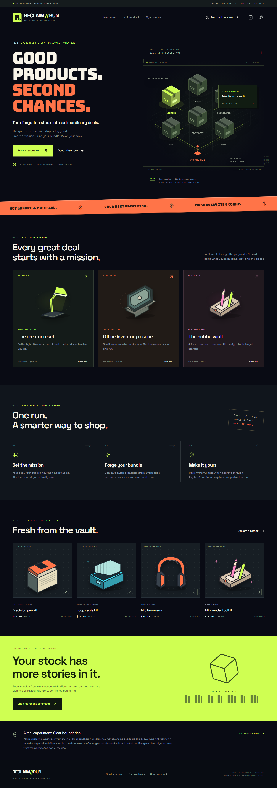
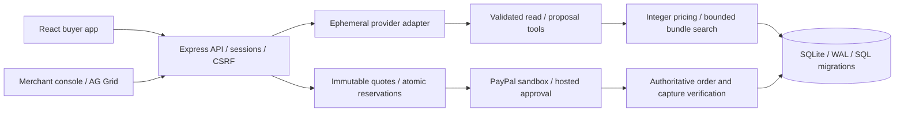
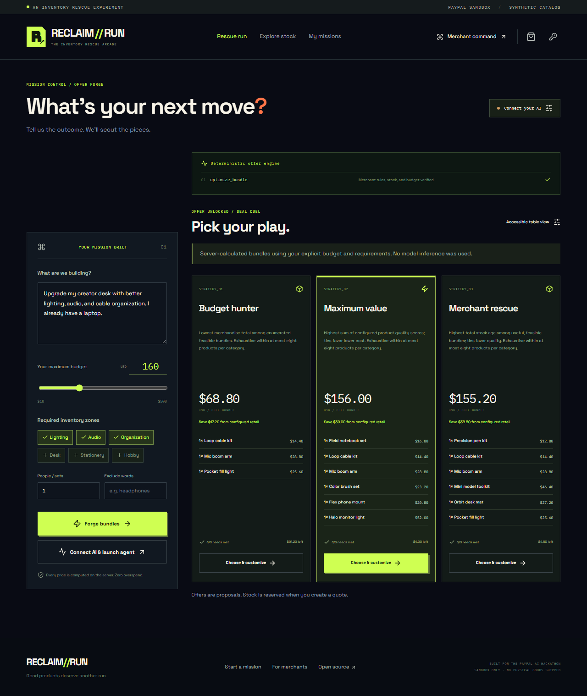
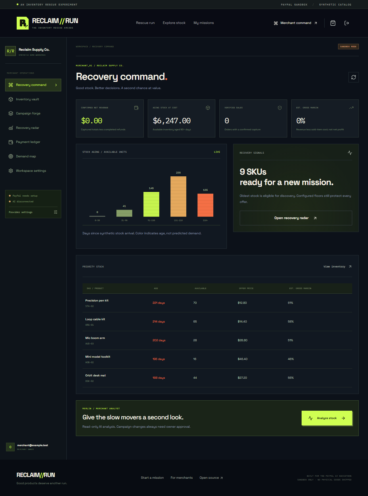

# RECLAIM//RUN

**Good products. Second chances.** An inventory rescue arcade built for the PayPal AI Hackathon 2026.

Turn a buyer's goal and budget into useful bundles from a merchant's actual inventory. AI can explore the catalog; deterministic TypeScript enforces prices, quantities and margins; PayPal sandbox confirmation governs settlement.



## Run locally

Requires Node.js **24+**, npm, and a modern browser. No paid model account is required for deterministic shopping.

```sh
git clone https://github.com/eshaanvgupta/reclaim-run-paypal-ai.git
cd reclaim-run-paypal-ai
npm ci
npm run setup
npm run dev
```

Open **http://localhost:3000**. Windows PowerShell users whose execution policy blocks npm scripts can use `npm.cmd` in place of `npm`.

`setup` creates SQLite, seeds 17 clearly synthetic products and prints a randomly generated merchant password. Save that password. Existing accounts and inventory are preserved. To choose the initial credentials yourself, set `MERCHANT_EMAIL` and `MERCHANT_PASSWORD` in a local `.env` before the first setup. Merchant sign-in is under **Merchant command**. Buyers can shop as guests or create an account in the sign-in dialog.

## What works

- Original industrial arcade interface, interactive inventory map, responsive buyer and merchant screens, self-hosted fonts and original SVG illustrations.
- Searchable persistent catalog, three mission scenarios, budget/quantity/category/exclusion constraints, three distinct bundle strategies when feasible, accessible comparison table, editable cart and server recalculation after edits.
- Transactional immutable quotes, atomic stock reservations, idempotent settlement, merchant inventory CRUD, validated transactional CSV import and column mapping.
- AG Grid Community inventory console, owner-approved campaigns, stock age heat map, real-record metrics, aggregated mission demand, financial ledger and audit trail.
- Guest sessions, durable buyer accounts, merchant owner/staff permissions, return requests, explicit refund/restock authorization.
- Real server integration with PayPal Orders v2, hosted approval redirects, capture verification, reconciliation, signed webhook verification and full refunds. **Live sandbox transactions remain unverified; credentials are required.**
- Genuine tool-executing AI runtime with an explicit connection dialog, per-run limits and SSE activity events. OpenAI-compatible providers, Anthropic, Gemini, and optional local Ollama are supported by adapters. **Live inference remains unverified; no user key or local model was supplied.**

## Your AI, your key

Open **Rescue run → Connect your AI** (also shown when launching an unconfigured agent). Choose OpenAI, Anthropic, Google Gemini, Groq, OpenRouter, Mistral, a custom OpenAI-compatible endpoint, or local Ollama. Enter the exact tool-capable model ID available to your account.

**We do not store or save API keys.** Keys remain only in React state for the current tab and in server memory while forwarding requests to your selected provider. They are never written to SQLite, browser storage, application logs, or the repository. Refreshing, navigating away from the app, or disconnecting clears the application's in-memory connection. This is a runtime design, not a guarantee of secure memory erasure. Your provider's retention and billing policies still apply.

The popup bounds output tokens per request and provider requests per run. These are **not guaranteed monetary spending limits**: input tokens, provider reasoning tokens, model pricing and account caps belong to your provider. No platform-owned AI service or shared paid key is required.

Custom providers must speak the OpenAI chat-completions tool protocol over public HTTPS. DNS results are validated and pinned; private networks, credentials embedded in URLs, redirects and alternate ports are rejected. Arbitrary proprietary provider protocols require another adapter.

For free local inference, install [Ollama](https://ollama.com/download) separately, then explicitly download the model:

```sh
ollama pull qwen3:4b
npm run ai:doctor
```

Qwen3 4B Q4_K_M is approximately 2.5 GB, Apache-2.0 licensed, and advertises tool support. Allow roughly 6–8 GB available system memory; latency depends on hardware and context. These are planning estimates, not hardware benchmarks. The app does not silently install Ollama or download weights. `npm run ai:setup` prints setup guidance. [Official model details](https://ollama.com/library/qwen3:4b), [official tool-calling protocol](https://docs.ollama.com/capabilities/tool-calling).

## PayPal sandbox setup

1. Sign in to the [PayPal Developer Dashboard](https://developer.paypal.com/dashboard/applications/sandbox) and create a **sandbox REST app** associated with your sandbox business merchant.
2. Put that app's client ID and secret into local `.env` as `PAYPAL_CLIENT_ID` and `PAYPAL_CLIENT_SECRET`. Set `PAYPAL_MERCHANT_ID` to the matching sandbox business account's merchant ID. Never use a personal buyer's ID as the payee.
3. Keep `APP_URL=http://localhost:3000`, then restart the app. PayPal is sandbox-only in server code.
4. Launch a mission, choose a bundle, reserve a quote, review the total and consent, then click **Continue to PayPal**.
5. Sign in on PayPal with a **separate sandbox personal buyer account**, approve, and return. Select the review checkbox, then **Complete approved payment**. The server retrieves and verifies the order and capture before recording a completed sale.
6. Inspect the receipt, merchant ledger, and stock quantities. Reconciliation is available from the checkout and the merchant ledger. Use a guest/private window for the buyer while signed in as the merchant elsewhere.
7. For webhooks, expose a trusted HTTPS endpoint, configure `APP_URL` and `SECURE_COOKIES=true`, register `/api/paypal/webhook` on that sandbox app and set `PAYPAL_WEBHOOK_ID`. Localhost cannot receive public PayPal webhooks. Local authenticated reconciliation works without webhooks.

No live-money endpoint is enabled. The seeded goods are synthetic sandbox demonstration goods, with zero tax and shipping and no physical shipment. PayPal approval is hosted by PayPal; no card data is collected.

See [payment lifecycle and failure handling](docs/PAYMENT_FLOW.md) for exact endpoints and reservation behavior.

## Verification

```sh
npm test
npm run build
npx playwright install chromium
npm run test:e2e
npm audit
```

Automated coverage includes pricing, authorization, real SQLite transactions, final-unit contention, duplicate callbacks, amount/currency/payee mismatch, refunds, key non-persistence, inventory imports and desktop/mobile flows. Provider responses in automated AI/payment tests are explicitly **mocked**. Those tests are not evidence of a real model call or PayPal transaction. See the [test report](docs/TEST_REPORT.md).

Optional live diagnostics:

```sh
npm run verify:paypal
npm run verify:ai
```

The first verifies sandbox OAuth only when `.env` credentials exist. The second defaults to actual local Ollama, records real tool names and bundle totals and fails when no model is reachable. To test your own provider from the terminal, set session-only `VERIFY_AI_PROVIDER`, `VERIFY_AI_MODEL` and `VERIFY_AI_KEY` environment variables; never commit them. The browser popup is the preferred normal path.

## Architecture



One modular Node server serves Vite in development and built React assets in production. Persistence uses Node's SQLite API and versioned SQL, without an ORM. Payments, optimization, auth, AI and UI are separate modules. Merchant code and AG Grid are loaded only when opening the merchant console. PostgreSQL and distributed deployment are future migrations, not implemented compatibility claims.

## Inventory import

Download the [sample CSV](public/sample-inventory.csv) or use Inventory vault → Import CSV. Money fields are **integer cents**, discounts/margins are **basis points**. Map alternate headers with JSON, for example `{"Product Code":"sku","Price Cents":"retail"}`.

Required columns: `sku,name,category,cost,retail,floor,stock`. Optional fields: `description,ageDays,quality,discountBps,marginBps,clearance,tags`. Categories are Lighting, Audio, Organization, Desk, Stationery, Hobby. All rows are validated before transaction commit. Duplicate SKUs or an invalid row roll back the import. Unsupported columns, arbitrary image URLs and negative quantities are rejected. Artwork is an original category illustration, not a photograph of an actual item for sale.

## Screenshots

| Buyer                                                         | Merchant                                                   |
| ------------------------------------------------------------- | ---------------------------------------------------------- |
|  |  |

[Mobile landing](docs/screenshots/landing-mobile.png) · [Mobile offers](docs/screenshots/offer-forge-mobile.png) · [Provider popup](docs/screenshots/provider-settings.png) · [Checkout setup boundary](docs/screenshots/checkout-unconfigured.png) · [Inventory vault](docs/screenshots/inventory-vault.png)

## Operations, limitations and submission

- [Architecture and security](docs/ARCHITECTURE.md)
- [Optimization details](docs/OPTIMIZATION.md)
- [Deployment and recovery](docs/DEPLOYMENT.md)
- [Commercialization and production limits](docs/COMMERCIALIZATION.md)
- [Devpost submission text](docs/DEVPOST_SUBMISSION.md)
- [Two-minute demo script and recording plan](docs/DEMO_SCRIPT.md)
- [Official rules and sponsor disclosure](docs/HACKATHON.md)
- [Third-party notices](THIRD_PARTY_NOTICES.md)

No public server deployment, live provider verification, YouTube publication or Devpost submission is claimed. A source repository is not a submitted hackathon entry.

## License

Original source and SVG assets are licensed under [Apache-2.0](LICENSE). Commercial use and hosted SaaS are permitted subject to the license. This does not give exclusive rights over other lawful users of the code, or establish trademark registration. Bundled fonts retain their SIL Open Font License notices. AG Grid Community uses its own MIT license; AG Studio/Enterprise are not installed.
