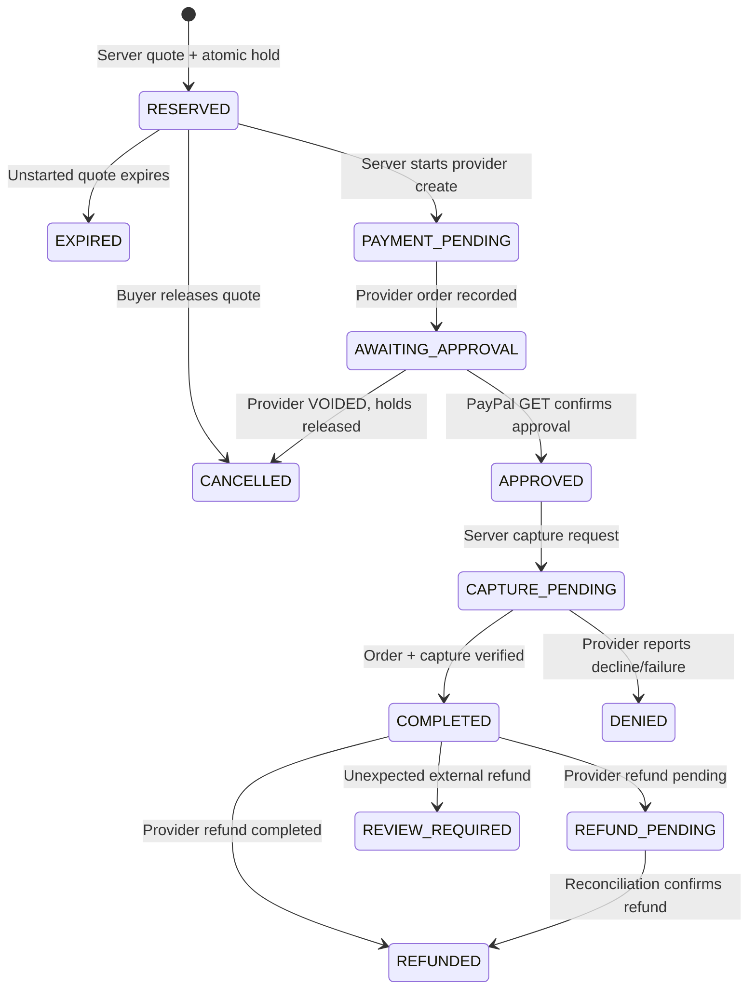

# Payment and inventory lifecycle

All integration endpoints target `https://api-m.sandbox.paypal.com`. Production payment processing is not enabled.

## Actual endpoints

| Operation                   | Endpoint                                          | Server module        |
| --------------------------- | ------------------------------------------------- | -------------------- |
| OAuth client credentials    | POST `/v1/oauth2/token`                           | `server/paypal.ts`   |
| Create CAPTURE-intent order | POST `/v2/checkout/orders`                        | `server/paypal.ts`   |
| Read authoritative order    | GET `/v2/checkout/orders/{id}`                    | `server/paypal.ts`   |
| Capture approved order      | POST `/v2/checkout/orders/{id}/capture`           | `server/paypal.ts`   |
| Read capture detail         | GET `/v2/payments/captures/{id}`                  | `server/commerce.ts` |
| Full merchant refund        | POST `/v2/payments/captures/{id}/refund`          | `server/paypal.ts`   |
| Reconcile pending refund    | GET `/v2/payments/refunds/{id}`                   | `server/commerce.ts` |
| Verify webhook              | POST `/v1/notifications/verify-webhook-signature` | `server/paypal.ts`   |

The frontend uses the returned PayPal-hosted `payer-action`/`approve` link. Approval links are restricted to HTTPS PayPal sandbox hosts. Buyer return URL parameters are not trusted as payment evidence. The server only captures the provider order already associated with that buyer's quote.

## Quotes and stock

Quotes have immutable lines, name/category snapshots, quantities, retail references, actual unit prices, cost basis, USD total, owning session and expiry. Cost snapshots remain merchant-private.

`BEGIN IMMEDIATE` protects stock reservations. Each conditional SQL update requires sufficient `stock - reserved - unavailable`. Quote creation, lines, holds and audit records commit together. A second buyer cannot claim the final reserved unit. Quotes are recalculated from current server catalog data, never browser totals.

Unstarted `RESERVED` quotes expire after 15 minutes and release held stock atomically. Cancellation can release only an unstarted quote. Once a PayPal create operation starts, the quote becomes `PAYMENT_PENDING`. Those holds are deliberately **not automatically released** while provider state may be ambiguous, including after network timeouts or buyer cancellation of the approval window. They require provider reconciliation. This conservative local design favors inventory integrity over automatic abandonment recovery.

The create request ID is the quote UUID. The capture request ID is the internal order UUID. Retry uses those same IDs and immutable payloads. A persisted CREATING order can retry creation idempotently after a timeout. Provider idempotency retention is finite; do not blindly retry ancient ambiguous requests. Resolve their status with PayPal support/account tools before manual recovery.

## State transitions

Network failure leaves a durable payment attempt and keeps stock held. It never becomes a successful sale automatically. A COMPLETED PayPal order with a pending capture remains CAPTURE_PENDING. A denial does not get a celebratory screen. Late captured money without a valid reservation is recorded as REVIEW_REQUIRED; inventory is not silently oversold and the capture ID is not discarded.

Before settlement, the server checks one purchase unit, quote custom/reference IDs, amount, currency and merchant ID, then retrieves capture details and checks captured amount, status and related PayPal order ID. A transaction decrements on-hand/reserved units and increments sold units once. Capture ID uniqueness and rechecked order state make replays harmless. A provider call is never executed inside a long-running SQLite transaction.

In-process serialization reduces duplicate network calls. Durable state, PayPal request IDs, conditional SQL updates and transaction checks remain essential after restarts. This implementation is intended for a **single Node process and local SQLite file**, not a multi-region cluster.

## Reconciliation, refunds and returns

Buyer quote routes require the owning guest session or registered buyer account. Merchant reconciliation requires owner/staff access. Webhooks require PayPal's remote signature-verification result before any durable event is accepted; repeated event IDs are deduplicated. A valid event triggers a fresh provider read instead of trusting event amounts.

The owner explicitly authorizes full refunds. The returned amount, currency and status are checked. Pending refunds do not count as completed refunded money. Reconciliation reads the recorded refund's provider status. External partial/full refunds are flagged for manual review rather than inventing a local amount. General partial-refund initiation is not implemented.

A refund does **not** restore inventory. Only an owner confirming inspected, saleable returned goods can restock an order, once. Buyer return requests are proposals, not payment mutations.

## Live verification boundary

No sandbox OAuth, create, approval, capture, refund or webhook delivery has been tested live in this build session: authorized sandbox credentials and an interactive buyer approval were unavailable. Automated mocked-provider tests prove local handling only. Record real order/capture/refund IDs and actual test outcomes before claiming a verified end-to-end PayPal demonstration.

Primary references: [Orders create](https://developer.paypal.com/api/orders/v2/orders-create), [Orders capture](https://developer.paypal.com/api/orders/v2/orders-capture), [webhook integration](https://developer.paypal.com/api/rest/webhooks/rest/).
